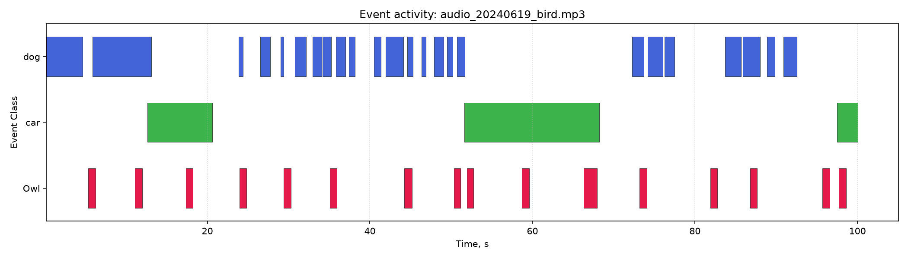

# Audio Annotation Visualizer

A tool for visualizing audio event annotations: it builds a spectrogram
of an audio recording, overlays events from a TSV annotation file (e.g.
exported from CVAT.ai, an Audacity Label Track, or a custom annotator),
draws a per-class event activity timeline, and computes summary
statistics.

If the TSV file contains annotations for multiple audio files, the
script automatically picks only the annotations for the file passed via
`--audio` (matched by filename).

## Example output

The sample data (`examples/owl.tsv`, `examples/audio_20240619_bird.mp3`)
is a 100-second recording containing owl (`Owl`), dog (`dog`), and car
(`car`) sounds.

Running the script produces:

- `output/<name>_spectrogram.png` — a mel-spectrogram with colored event
  bands overlaid on top (one color per class, with a legend);
- `output/<name>_timeline.png` — a standalone activity plot, with each
  event class on its own row along the time axis;
- `output/<name>_stats.txt` / `.csv` — statistics: event count per
  class, total/mean/min/max duration, and share of labeled time.

Example activity plot (audio-free, generated from the annotations alone):



## Installation

```bash
git clone <repository-url>
cd audio-annotation-visualizer
python -m venv .venv && source .venv/bin/activate  # Windows: .venv\Scripts\activate
pip install -r requirements.txt
```

> Reading mp3 files requires `soundfile`/`ffmpeg`. `requirements.txt`
> usually covers this, but on some systems you may also need to install
> `ffmpeg` via your system package manager.

## Annotation format (TSV)

Required columns (tab-separated):

| filename                 | start             | stop              | label |
|---------------------------|-------------------|--------------------|-------|
| audio_20240619_bird.mp3   | 0:00:05.355000    | 0:00:06.248000     | Owl   |

Time is given as `H:MM:SS.ffffff` (the standard `timedelta` string
format) or as a plain number of seconds. The `id`, `source`, and `score`
columns are optional.

## Usage

```bash
python main.py \
    --audio examples/audio_20240619_bird.mp3 \
    --tsv examples/owl.tsv \
    --output-dir output
```

Useful flags:

| Flag                   | Description                                                  | Default    |
|-------------------------|---------------------------------------------------------------|------------|
| `--spectrogram-type`   | `mel` (mel scale) or `stft` (linear frequency scale)          | `mel`      |
| `--sr`                 | Target sampling rate                                          | original   |
| `--n-fft`              | FFT window size                                                | `2048`     |
| `--hop-length`         | Window step (hop length)                                       | `512`      |
| `--no-show`            | Don't display plots interactively, only save the files         | disabled   |

## Project structure

```
audio-annotation-visualizer/
├── main.py                # CLI: ties all steps together into one pipeline
├── src/
│   ├── annotations.py     # TSV loading, time parsing, validation
│   ├── audio.py           # Audio loading + spectrogram computation (librosa)
│   ├── visualize.py       # Spectrogram with events + activity timeline plot
│   └── stats.py           # Per-class event statistics
├── tests/
│   └── test_annotations.py
├── examples/               # Sample data
├── output/                 # Generated plots/reports are saved here
└── requirements.txt
```

## Using it as a library

```python
from src.annotations import load_annotations
from src.audio import load_audio, compute_spectrogram
from src.visualize import plot_spectrogram_with_events
from src.stats import compute_stats

ann = load_annotations("examples/owl.tsv").for_file("audio_20240619_bird.mp3")
clip = load_audio("examples/audio_20240619_bird.mp3")
S_db, times, freqs = compute_spectrogram(clip)

plot_spectrogram_with_events(S_db, times, freqs, ann, output_path="out.png")
print(compute_stats(ann))
```

## Tests

```bash
pip install pytest
pytest tests/
```

## License

MIT — see [LICENSE](LICENSE).